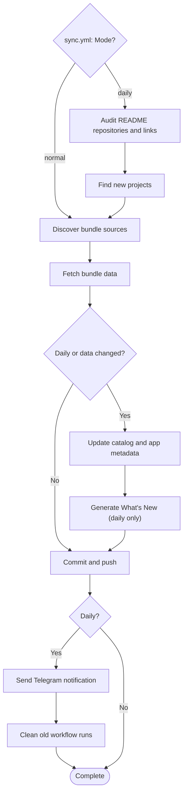
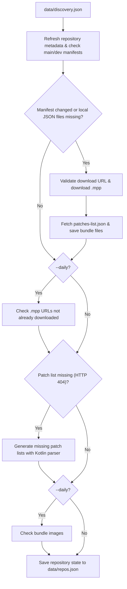
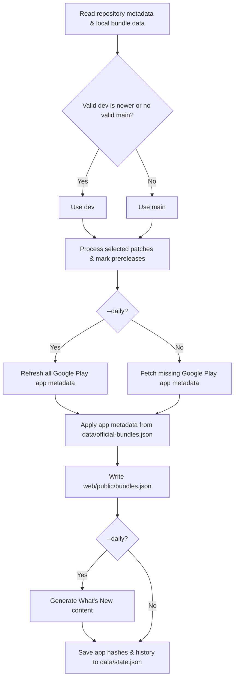

## [nvbangg/awesome-morphe](https://github.com/nvbangg/awesome-morphe)

<div align="center">

[](https://github.com/vercel/next.js)
[](https://github.com/react/react)
[](https://github.com/microsoft/TypeScript)
[](https://github.com/nodejs/node)
[](https://github.com/tailwindlabs/tailwindcss)
[](https://github.com/python/cpython)
[](https://github.com/openjdk/jdk)
[](https://github.com/JetBrains/kotlin)

[](https://github.com/pnpm/pnpm)
[](https://github.com/astral-sh/uv)
[](https://github.com/gradle/gradle)
[](https://github.com/biomejs/biome)
[](https://github.com/astral-sh/ruff)
[](https://github.com/astral-sh/ty)
[](https://github.com/nvbangg/awesome-morphe/actions)
[](https://www.cloudflare.com/)

</div>

### 🔗 Jump to:

- [📂 Project Structure](#project-structure)
- [💻 Local Development](#local-development)
  - [🌐 Website](#website)
  - [🐍 Scripts](#local-scripts)
- [🤖 Automation Workflows](#automation-workflows)
- [🛠️ Script Logic](#script-logic)
- [🌐 Website Logic](#website-logic)

> [!NOTE]
> This document describes the project structure, automation workflows, and data-processing logic behind the [Awesome Morphe Website](https://awesome-morphe.pages.dev/).

## <a id="project-structure"></a> 📂 Project Structure

```text
awesome-morphe/
├── .github/   # Automation workflows
├── data/      # Raw fetched data, source configuration & sync state
├── scripts/   # Automated data-processing scripts
├── web/       # Website source code
│   ├── public/
│   │   ├── bundles.json    # Metadata of all active bundles, patches & apps
│   │   └── whats-new.json  # Rolling changelog
│   └── ...
├── CONTRIBUTING.md
├── LICENSE
└── README.md
```

## <a id="local-development"></a> 💻 Local Development

### <a id="website"></a> 🌐 Website

Run the following commands from [`web/`](./web/) (`cd web` from the repository root).

#### Environment Setup

Install [Node.js](https://nodejs.org/en/download) (>= 24) then run:

```sh
npm install -g pnpm
pnpm install --frozen-lockfile
pnpm exec playwright install chromium
```

#### Running

Run the development server:

```sh
pnpm dev
```

#### Checks

Check formatting, lint, types, and run unit and desktop/mobile browser tests:

```sh
pnpm check
pnpm test
pnpm test:e2e
```

### <a id="local-scripts"></a> 🐍 Scripts

Run the following commands from [`scripts/`](./scripts/) (`cd scripts` from the repository root).

#### Environment Setup

Install [uv](https://docs.astral.sh/uv/getting-started/installation/) then run:

```sh
uv sync --locked
cp .env.example .env
```

Configure `.env` as described in [`.env.example`](./scripts/.env.example).

Install [JDK 21](https://www.oracle.com/java/technologies/downloads/#java21) to parse bundles without `patches-list.json`. Set `JAVA_HOME` in `.env` to its installation directory if needed.

Bundle parsing also requires `GITHUB_ACTOR` and a `GITHUB_TOKEN` with `read:packages` for GitHub Packages access.

For GitHub Actions, add the corresponding values to repository secrets as needed.

#### Running

[`main.py`](./scripts/main.py) is the single CLI entry point for normal or daily sync and individual tasks. It automatically loads `scripts/.env`, overriding inherited environment variables for the script and its child processes.

| Command | Purpose |
| --- | --- |
| `uv run main.py` | Run normal sync |
| `uv run main.py --daily` | Run daily sync |
| `uv run main.py audit-readme` | Audit README repositories and links |
| `uv run main.py find-projects` | Find new projects |
| `uv run main.py discover` | Discover bundle sources |
| `uv run main.py fetch` | Fetch bundle data |
| `uv run main.py fetch --daily` | Fetch with daily checks |
| `uv run main.py update` | Update catalog and app metadata |
| `uv run main.py update --daily` | Update with daily refresh and changelog generation |
| `uv run main.py telegram` | Send Telegram notification |

Use `uv run main.py --help` or `uv run main.py COMMAND --help` for available arguments.

#### Checks

Check formatting, lint, types, and run tests:

```sh
uv run ruff check --fix .
uv run ruff format .
uv run ty check
uv run pytest
```

## <a id="automation-workflows"></a> 🤖 Automation Workflows

### [Sync Workflow](../../actions/workflows/sync.yml) ([sync.yml](./.github/workflows/sync.yml))

[`ci.yml`](./.github/workflows/ci.yml) (triggered by a Cloudflare Worker every 3 hours) selects `daily` until a daily sync succeeds for the current UTC day, then `normal`. It triggers [`sync.yml`](./.github/workflows/sync.yml) with the selected mode.



## <a id="script-logic"></a> 🛠️ Script Logic

<div align="center">

[](https://github.com/python/cpython)
[](https://github.com/openjdk/jdk)
[](https://github.com/JetBrains/kotlin)

[](https://github.com/pydantic/httpx2)
[](https://github.com/pydantic/pydantic)
[](https://github.com/JoMingyu/google-play-scraper)
[](https://github.com/theskumar/python-dotenv)
[](https://github.com/MorpheApp/morphe-patcher)

[](https://github.com/astral-sh/uv)
[](https://github.com/gradle/gradle)
[](https://github.com/astral-sh/ruff)
[](https://github.com/astral-sh/ty)
[](https://github.com/pytest-dev/pytest)
[](https://github.com/nvbangg/awesome-morphe/actions)
[](https://developers.cloudflare.com/workers/)

</div>

Core automation scripts are written in Python under [`scripts/`](./scripts/), with a Java/Kotlin parser for `.mpp` files.

```text
scripts/
├── main.py                 # Run sync tasks
├── discover.py             # Discover bundle sources
├── fetch.py                # Fetch bundle data
├── update.py               # Update catalog and app metadata
├── audit_readme.py         # Audit README repositories and links
├── find_projects.py        # Find new projects
├── telegram.py             # Send Telegram notification
├── common/                 # Shared utilities and data schemas
├── discovery/              # Bundle source providers
│   ├── jman.py             # Fetch Jman sources
│   ├── morphe_archive.py   # Fetch Morphe Archive sources
│   └── official.py         # Fetch official Morphe sources
├── updater/                # Catalog, app metadata and changelog processing
│   ├── gplay_scrape.py     # Sync Google Play and official app metadata
│   ├── local_data.py       # Parse and select local bundle data
│   └── whats_new.py        # Generate What's New content
├── bundle-parser/          # Java/Kotlin .mpp parser
├── tests/                  # Python tests
├── .env.example            # Environment configuration template
└── ...                     # Other configuration files
```

### Discover bundle sources ([discover.py](./scripts/discover.py))

Collects bundle sources from the providers below, combines them with manual configuration, and saves the list to [`data/discovery.json`](./data/discovery.json). If a provider is unavailable or returns no sources, its saved list is kept.

#### Discovered Sources

- Custom sources in [`data/custom.json`](./data/custom.json)
- [Morphe Community Patches](https://morphe-patches.software)
- [Jman's Patch Bundle Registry](https://github.com/Jman-Github/Patch-Bundle-Registry)
- [Morphe Archive](https://github.com/rushiforai/morphe-archive)

#### Custom Configuration

Add sources to [`data/custom.json`](./data/custom.json), or set `enabled: false` to exclude them.

```json
{
  "https://github.com/owner/repo-to-add": {},
  "https://gitlab.com/owner/repo-to-exclude": {
    "enabled": false
  },
  "https://gitlab.com/disabled-owner": {
    "enabled": false
  }
}
```

### Fetch bundle data ([fetch.py](./scripts/fetch.py))



Disabled repositories are skipped. Temporary errors keep saved data; unavailable or invalid branches are excluded.

### Update catalog and app metadata ([update.py](./scripts/update.py))



Disabled repositories and bundles without valid branch data are skipped.

Bundle names use `main`, then `dev`. Bundles without valid `main` data and dev-only patches are prereleases; apps are prerelease only if all their patches are.

*History and bundle files use repository IDs to preserve data and prevent duplicate announcements when repositories are renamed or bundles return.*

### Audit README repositories and links ([audit_readme.py](./scripts/audit_readme.py))

Reports unavailable or archived repositories, repository renames, and broken or redirected links from [`data/projects.json`](./data/projects.json) for review.

### Find new projects ([find_projects.py](./scripts/find_projects.py))

Finds standalone Morphe projects on GitHub and saves candidates to `newRepos` in [`data/projects.json`](./data/projects.json) for review. Skips repositories in `readmeRepos` or `excludedRepos`.

### Send Telegram notification ([telegram.py](./scripts/telegram.py))

Sends Markdown using `TG_TOKEN` and `TG_CHAT`. Skips missing or empty files.

- **Default:** Sends `scripts/temp/whats-new.md`, titled `🔔 What's New (Month Day)`.
- **`"Custom Title"`:** Sets the title.
- **`"Custom Title" "path/to/file.md"`:** Sets the title and input file.

## <a id="website-logic"></a> 🌐 Website Logic

<div align="center">

[](https://github.com/nodejs/node)
[](https://github.com/microsoft/TypeScript)
[](https://github.com/vercel/next.js)
[](https://github.com/react/react)
[](https://github.com/tailwindlabs/tailwindcss)

[](https://github.com/mui/base-ui)
[](https://github.com/TanStack/query)
[](https://github.com/47ng/nuqs)
[](https://github.com/colinhacks/zod)
[](https://github.com/lucide-icons/lucide)
[](https://github.com/pacocoursey/next-themes)

[](https://github.com/pnpm/pnpm)
[](https://github.com/postcss/postcss)
[](https://github.com/react/react/tree/main/compiler)
[](https://github.com/biomejs/biome)
[](https://github.com/webpro-nl/knip)
[](https://github.com/vitest-dev/vitest)
[](https://github.com/microsoft/playwright)
[](https://github.com/dequelabs/axe-core-npm)
[](https://github.com/vercel/serve)
[](https://pages.cloudflare.com/)

</div>

The website is built with Next.js and React in TypeScript under [`web/`](./web/) and exported as a static site.

```text
web/
├── src/                   # Website source code
│   ├── app/               # Routes, layout and providers
│   │   ├── apps/          # App catalog route
│   │   ├── bundles/       # Bundle catalog route
│   │   ├── whats-new/     # What's New route
│   │   ├── layout.tsx     # Root layout and site metadata
│   │   ├── page.tsx       # Home page with app catalog
│   │   └── providers.tsx  # Query, theme and URL state providers
│   ├── components/        # Shared UI and layout components
│   │   ├── common/        # Shared UI components
│   │   └── layout/        # Header, footer and theme controls
│   ├── features/          # Feature-specific views and data handling
│   │   ├── catalog/       # Data model, search and detail views
│   │   ├── test-bundle/   # Remote patch-list previews
│   │   └── whats-new/     # Changelog loading and views
│   ├── hooks/             # Shared React hooks
│   ├── lib/               # HTTP, string and formatting helpers
│   ├── constants/         # Shared application constants
│   └── index.css          # Global styles and color tokens
├── public/                # Static assets and generated data
│   ├── assets/            # Site icons and images
│   ├── bundles.json       # Generated app and bundle catalog
│   └── whats-new.json     # Generated What's New content
├── tests/                 # Unit tests and fixtures
├── e2e/                   # Browser and accessibility tests
└── ...                    # Other configuration files
```

Loads the catalog from [`web/public/bundles.json`](./web/public/bundles.json) and What's New from [`web/public/whats-new.json`](./web/public/whats-new.json).

### Sorting

#### Apps

- **Default:** Most Google Play installs, then most patches, then name. Universal patches stay last.
- Other sorts: newest, updated, patch count, or name. Ties use the default order. Recently updated uses the latest patch change recorded for each app.

#### Bundles

- **Default:** Uses the [Morphe Hot ranking](https://morphe-patches.software/), with `MorpheApp/morphe-patches` first. Remaining bundles updated within 30 days are sorted by stars then update time; older bundles follow, sorted by update time then stars. This order is stored as `hotRank`.
- Other sorts: newest, updated, stars, app count, patch count, or name. Ties use the default order.

#### Patches

Patches first seen within seven days are sorted newest first, followed by older patches in their original order.

### Search and Filters

All search words must match. Matching ignores case, accents, and punctuation.

- **Apps:** Name, package name, and description.
- **Bundles:** Name, source, and repository.
- **Details:** App/bundle names, package/repository names, patch text, and options.

Apps filter by Google Play category or "Not on Google Play"; bundles by official/unofficial status.

### Status Labels

- **New:** First seen within seven days.
- **Pre-release:** Uses prerelease bundle or patch data; applies to an app only when all its patches are prerelease.
- **Unofficial:** Not in the official bundle list.
- **Archived:** Repository is archived.
- **off:** Patch is disabled by default.

### URL Navigation

Pages: `/` (or `/apps`), `/bundles`, and `/whats-new`. Query parameters control sorting and filters (`?sort=stars&category=official`) and open details:

- `?app=package.name` opens an app.
- `?github=owner/repo` or `?gitlab=owner/repo` opens a bundle.
- `?patch=patch-name` searches patches in the open detail view.

### Test Bundle

Previews `patches-list.json` from `main` and `dev` on GitHub or GitLab. Does not parse `.mpp` files or add bundles to the catalog.
