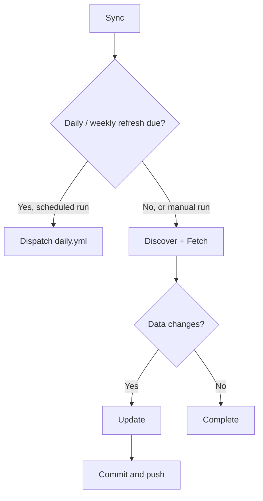
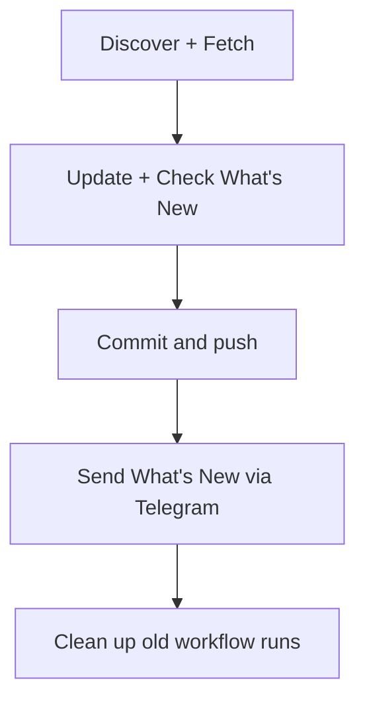

## [nvbangg/awesome-morphe](https://github.com/nvbangg/awesome-morphe)

> [!NOTE]
> This document describes the project structure, automation workflows, and data-processing logic behind the [Awesome Morphe Website](https://awesome-morphe.vercel.app/).

## 📂 Project Structure

```text
awesome-morphe/
├── .github/                            # Automation workflows
├── data/                               # Raw fetched data, source configuration & sync state
├── scripts/                            # Automated data-processing scripts
├── web/                                # Website source code
│   ├── public/
│   │   ├── bundles.json                # Metadata of all active bundles, patches & apps
│   │   └── whats-new.json              # Rolling changelog
│   └── ...                             # Other supporting files
├── CONTRIBUTING.md
├── LICENSE
└── README.md
```

## 🤖 Automation Workflows

### [Sync Workflow](../../actions/workflows/ci.yml) (ci.yml)

Runs hourly at minute 17 or manually. Scheduled runs dispatch the Daily / Weekly workflow when a refresh is due; otherwise, they perform a fast sync.



### [Daily / Weekly Workflow](../../actions/workflows/daily.yml) (daily.yml)

Triggered by Sync or manually:

- **`daily`:** Syncs bundles, checks bundle images, and refreshes repository metadata.
- **`weekly`:** Also checks existing bundle downloads and refreshes all Google Play metadata.

Both modes audit README links, find standalone projects, update public data, generate the changelog, and clean up old workflow runs. Java 21 is set up before fetching; fetch invokes the parser only when patch lists are missing (HTTP 404).



## 🛠️ Scripts

Core automation scripts are written in Python under [`scripts/`](./scripts/).

### [`discover.py`](./scripts/discover.py)

Collects bundle sources from the providers below and synchronizes [`data/repos.json`](./data/repos.json).

With `--daily` or `--weekly`, also runs README audits and standalone project discovery. Reports are grouped under **Discovery**.

#### Discovered Sources

- Custom sources in [`data/discover/custom.json`](./data/discover/custom.json)
- [Morphe Community Patches](https://morphe-patches.software)
- [Jman's Patch Bundle Registry](https://github.com/Jman-Github/Patch-Bundle-Registry)
- [Morphe Archive](https://github.com/rushiforai/morphe-archive)

#### Custom Configuration

Add sources to [`data/discover/custom.json`](./data/discover/custom.json), or set `enabled: false` to exclude them.

```json
{
  "https://github.com/owner/repo-to-add": {},
  "https://gitlab.com/owner/repo-to-exclude": {
    "enabled": false
  }
}
```

#### Repository State

`data/repos.json` uses a full GitHub or GitLab repository URL as its key. Different hosts remain independent, even when their owner and repository paths match. New sources start as `{}`; discovery preserves existing hashes, names, repository metadata, and pending renames.

```json
{
  "https://github.com/owner/repo": {
    "main": "main-metadata-hash",
    "dev": null,
    "image": "main-image-hash",
    "name": "Example Patches",
    "description": "Example patch bundle",
    "avatarUrl": "https://avatars.githubusercontent.com/u/12345",
    "stars": 100,
    "isArchived": true
  }
}
```

`main`, `dev`, and `image` retain their hash/null meanings. `image` refers only to `patches-bundle.png` on `main`. Repository metadata is omitted until fetched; `isArchived` is present only when true. `renamedTo` contains the destination URL only while a rename is waiting for update to apply it. Hashes, history, and changelog bundle keys also use full repository URLs.

### [`fetch.py`](./scripts/fetch.py)

Checks metadata hashes for GitHub and GitLab targets (`source`, repository, `main`/`dev` branch). Unchanged targets with a nonempty stored hash and both local JSON files skip downloads; a local `.mpp` is not required. The hash tracks downloaded data, not patch-list validity.

Each concurrent worker downloads metadata, checks its `.mpp` URL against the source repository, downloads the `.mpp`, and attempts to read its manifest name. GitLab numeric project URLs retain their existing rewrite. Downloads stay in memory until the target has completed its network requests, then overwrite the normal paths in `data/bundles/`, `data/patches/`, and `scripts/bundle-parser/mpp/`.

- A downloaded patch list is saved verbatim, even when its JSON or contents are invalid. Validation belongs to `update.py`; an invalid downloaded list never triggers parsing.
- Only a patch-list HTTP 404 queues the downloaded `.mpp` for parsing. Other patch-list HTTP errors, including 451, preserve the previous files and hash.
- Connection failures, timeouts, and other HTTP errors preserve the previous files and hash. There are no retries within a run.
- Unavailable metadata or `.mpp` downloads (HTTP 404/451), malformed metadata, and invalid download URLs clear the target hash to `null`. Existing files are retained but excluded by update.
- Missing hash headers are reported as check failures, not missing metadata. Name extraction is optional: unreadable archives or manifests and missing or blank names keep the existing display-name fallback without rejecting the target. Fetch does not scan archive contents or validate Morphe runtime compatibility.

After workers finish, fetch runs the Kotlin [`bundle-parser`](./scripts/bundle-parser/) once for the current queue in `updated_files.txt`. The parser remains adapted from [Jman's Patch Bundle Registry](https://github.com/Jman-Github/Patch-Bundle-Registry) for this project and Morphe. Fetch removes the previous `parsed_files.txt` before launch. A parsed target receives its new hash only when the process succeeds, lists that target in the current success file, and the output file exists. Output content is checked later by update. Individual parse failures clear only those targets' hashes; parser launch/build failures or missing success reports stop the pipeline before update or publication. File-write failures also stop the pipeline.

Fetch selects one display name per repository after branch processing: a branch with a nonempty hash is available, and `main` takes priority over `dev`. This does not change whether a dev target is downloaded or parsed. An unchanged preferred branch keeps its saved name. When the preferred branch changes or no name has been saved, fetch reads that branch's local `.mpp`, downloading it if necessary. Missing manifest names retain the existing fallback. Name selection does not depend on timestamps or worker completion order.

Fetch also retrieves repository descriptions, avatars, stars, archive status, and canonical paths through `scripts/common/repo_info.py`, shared with the README audit. Default runs request missing metadata; daily/weekly runs refresh repositories with a nonempty branch hash. Existing repositories are checked before branch downloads so a confirmed rename can validate a download URL under the new path; newly downloaded repositories are checked afterward. Each repository is requested at most once per run. Request failures preserve saved metadata and branch hashes. Successful unarchive responses remove `isArchived`.

A changed canonical path records `renamedTo` without changing the repository key or custom sources. Update applies the rename. Fetch collects results in memory and writes `data/repos.json` once after processing, including independent image and repository metadata updates. It does not use `pending_repos.json` or a separate parse script.

The Fetch summary always shows `Fetch (successful/total)`, counting each repository URL once across branches. GitHub and GitLab URLs count separately. A repository succeeds when at least one branch completes fetching or parsing without an error and has a nonempty hash; unchanged branches count as successful, while retaining an old hash after a failed request does not. Image and repository-metadata errors do not affect this count. Errors are grouped under **Bundle metadata**, **Bundle download**, **Patch list**, **Bundle image**, and **Repository metadata**; only the metadata group's contents are collapsed inside a details block. Branch errors appear only when both `main` and `dev` fail for the same source and repository. Each error group counts distinct repository URLs and shows one line per repository. Identical branch errors appear once without branch labels; different errors in the same group share one line as `(main) reason; (dev) reason`. Errors in different groups remain in their respective groups with branch labels, so group counts can overlap. Requests report their actual HTTP status or exception reason. Metadata validation reports `Invalid data` or `Invalid download_url` without including the download URL. Patch-list HTTP 404 is reported only if parsing fails, as one generation failure. Image errors are independent of branch results; HTTP 404/451 means no image and produces no warning. Empty groups are omitted. Fatal parser or file-write failures stop the workflow; their details remain in workflow logs.

#### Execution Modes

- **Default:** Checks and downloads bundle updates, parses only missing patch lists, and fetches missing repository metadata.
- **`--daily`:** Also checks hashes of `patches-bundle.png` on `main` and refreshes repository metadata.
- **`--weekly`:** Includes daily behavior and checks `.mpp` availability for unchanged targets. HTTP 404/451 clears the branch hash; other request failures preserve it.

Only metadata hashes trigger updates, so changes made solely to a patch list without changing its metadata are not detected.

### [`update.py`](./scripts/update.py)

Compiles bundle, patch, and app data into [`web/public/bundles.json`](./web/public/bundles.json).

#### Bundle Selection

Each repository URL produces an independent bundle. GitHub and GitLab repositories with the same path can both appear on the website. Within each repository, `dev` is selected when its `created_at` is newer than `main` or no valid `main` exists; otherwise, `main` is selected. A timestamp tie selects `main`. Display names follow fetch's separate main-first rule.

Bundles without valid `main` data are marked prerelease. Patches found only in `dev` are also marked prerelease when compared with `main`. Branches with null hashes are ignored. Download URL ownership is checked by fetch; update does not repeat that check against local filenames after a rename. Downloaded and parser-generated patch lists share the same local validation: malformed JSON, invalid structure, empty lists, and template-only bundles are excluded without restoring previous patch data. A downloaded hash remains a download checkpoint, even when update rejects its patch list.

The Update summary always shows `Update (successful/total)`. The total counts input repositories with at least one nonempty branch hash; success means at least one usable local branch. Both counts treat a repository URL as one item across branches, before renames or rename collisions. Different hosts count separately. Incomplete app metadata does not reduce the success count. Incomplete apps missing a name appear first, with alphabetical package order within each group. Errors are grouped under **Patch list** and **Incomplete Apps**. Repository-metadata warnings belong to Fetch. Patch-list errors appear only when neither branch is usable for the same source and repository; a valid branch keeps the other branch's errors in console logs only. The Patch list group counts distinct repository URLs and shows one line per repository. Identical branch errors appear once without branch labels; different branch errors share one line as `(main) reason; (dev) reason`. Branches with null or empty hashes are skipped and do not count as usable branches. Invalid content reports `Invalid data`, empty patch lists report `No patches found`, and template-only lists identify `com.example.app`. Request failures report the actual HTTP status or exception reason. The summary does not repeat metadata-download or `.mpp` failures already handled by fetch, or report a separate total of excluded repositories. Empty groups are omitted. Summary sections use icons only in their level-two headings; level-three group headings have no icons.

#### Metadata and Cleanup

Reads repository metadata from `data/repos.json` and fetches app metadata from Google Play. It does not request GitHub/GitLab repository metadata. Custom star adjustments and bundle-image precedence are applied locally. Nonempty app names, icons, and descriptions from [`data/official-bundles.json`](./data/official-bundles.json) take priority.

Pending renames stay in memory until final output is ready. Update transfers repository identity, hashes, history, and local bundle/patch-list filenames to the destination URL, disables the old custom source, enables discovery of the destination, and removes `renamedTo`. An existing destination keeps its data; the old source is discarded without merging across hosts. After branch selection and rename handling, apps no longer supported by a final bundle are removed before Google Play requests. Compatibility data stays inline during processing; the public compatibility table and keys are built once from the final patches, preserving the existing public schema.

Only after the final catalog is built does update write the catalog, app hashes, history, and any renamed source configuration. Hashes and history use final repository names. Orphaned bundle and patch files are removed at the end; failures before final output leave these files and persisted state unchanged.

#### Execution Modes

- **Default / `--daily`:** Processes local bundle data and fetches missing app metadata.
- **`--weekly`:** Also refreshes Google Play metadata for all apps.

Daily and weekly updates also generate What's New from the data already in memory. Default updates do not advance the changelog baseline.

### [`updater/whats_new.py`](./scripts/updater/whats_new.py)

Called by daily/weekly Update to compare current bundle, app, and patch names with [`data/history.json`](./data/history.json), using full repository URLs as identities. Saves the latest 14 changelog entries to [`web/public/whats-new.json`](./web/public/whats-new.json) and generates [`scripts/temp/whats-new.md`](./scripts/temp/whats-new.md) when there is content to announce. New entries update history for current valid bundles while retaining snapshots of unavailable bundles, so returning bundles and previously known apps are not announced as new. History is not reconstructed from leftover patch-list files.

### [`telegram.py`](./scripts/telegram.py)

Sends update notifications using `TG_TOKEN` and `TG_CHAT`.

- **Default:** Sends [`scripts/temp/whats-new.md`](./scripts/temp/whats-new.md) with the title `🔔 What's New (Month Day)`.
- **`"Custom Title"`:** Uses a custom title.
- **`"Custom Title" "path/to/file.md"`:** Uses a custom title and file.

### [`audit_readme.py`](./scripts/discovery/audit_readme.py)

Checks repositories in [`data/projects/readme-repos.txt`](./data/projects/readme-repos.txt) and links in [`data/projects/readme-links.txt`](./data/projects/readme-links.txt) for unavailable, archived, renamed, or redirected targets. Reports findings without editing README.

### [`find_projects.py`](./scripts/discovery/find_projects.py)

Searches GitHub for standalone Morphe projects, excluding known repositories and those with `patches-bundle.json` on `main` or `dev`. Candidates must have a README. Saves results to [`data/projects/new-projects.txt`](./data/projects/new-projects.txt) for review.

## 🌐 Website Logic

The website loads its bundle data from [`web/public/bundles.json`](./web/public/bundles.json) and changelog from [`web/public/whats-new.json`](./web/public/whats-new.json).

### Sorting

#### Apps

- **Default:** Most Google Play installs, then most patches and alphabetical order. Universal patches are always listed last.
- Other options sort by newest, recently updated, most patches, or alphabetical order, falling back to the default order when values are equal.

#### Bundles

- **Default:** Official bundles follow the Hot ranking from [Morphe Community Patches](https://morphe-patches.software/), with `MorpheApp/morphe-patches` first. Other bundles updated within 30 days are sorted by stars, then last update; older bundles are sorted by last update, then stars. [`update.py`](./scripts/update.py) stores the final order as `hotRank`.
- Other options sort by newest, recently updated, stars, app count, patch count, or alphabetical order. Ties use the default rank.

#### Patches

Patches first seen within the last seven days are shown first, with newer patches ahead of older ones. Other patches keep their original order.

### Search and Filters

Search ignores case, accents, spaces, and punctuation. All search words must match:

- Apps are searched by name, package name, and description.
- Bundles are searched by name, source, and repository.
- Detail views also search app, bundle, patch, and patch-option information.

App filters use Google Play categories, while bundle filters separate official and unofficial sources.

### Status Labels

- **New:** First discovered within the last seven days.
- **Pre-release:** Available only from prerelease bundle or patch data. An app is prerelease when all its patches are prerelease.
- **Unofficial:** The bundle is not included in the official Morphe source list.
- **Archived:** The source repository is archived.
- **off:** The patch is disabled by default.

### URL Navigation

The URL stores the active tab, category, and sorting in its hash, such as `#apps:updated` or `#bundles:official:stars`. Query parameters open specific content directly:

- `?app=package.name` opens an app.
- `?github=owner/repo` or `?gitlab=owner/repo` opens a bundle.
- `?patch=patch-name` searches within the opened app or bundle.

### Test Bundle

Test Bundle accepts a GitHub or GitLab repository URL and previews valid `patches-list.json` data from its `main` and `dev` branches. It does not parse `.mpp` files or add the repository to the public database.

## 💻 Local Development

Run commands from the repository root unless stated otherwise.

### Website

```sh
cd web
npm ci
npm run dev
```

Open the local URL shown in the terminal.

### Data Scripts

Scripts automatically load the optional `scripts/.env` file, regardless of the working directory. Existing environment variables take priority over values in this file. Loaded variables are also inherited by child processes, including Gradle. The file is ignored by Git and is not required in GitHub Actions.

```sh
python -m pip install -e scripts/
python scripts/discover.py
python scripts/fetch.py
python scripts/update.py
```

Set `GITHUB_TOKEN` for authenticated GitHub requests. Parsing `.mpp` files requires JDK 21 and GitHub Packages credentials: `GITHUB_ACTOR` and `GITHUB_TOKEN`, or Gradle properties `gpr.user` and `gpr.key`.

### Checks

Run website checks from [`web/`](./web/):

```sh
npm run check
npm run build
```

Run Python checks from the repository root:

```sh
python -m pip install ruff
ruff check --fix scripts/
ruff format scripts/
```

Run Python regression tests from [`scripts/`](./scripts/). They use temporary local fixtures and mock network requests and Gradle; no remote bundles are downloaded or executed:

```sh
python -B -m unittest discover -s tests -v
```

Lint and formatting commands may modify files.
