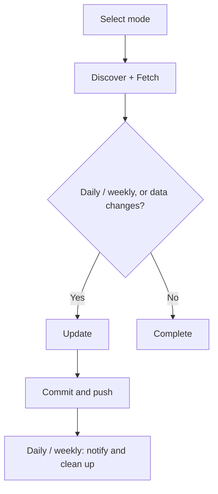

## [nvbangg/awesome-morphe](https://github.com/nvbangg/awesome-morphe)

> [!NOTE]
> This document describes the project structure, automation workflows, and data-processing logic behind the [Awesome Morphe Website](https://awesome-morphe.vercel.app/).

## 📂 Project Structure

```text
awesome-morphe/
├── .github/                            # Automation workflows
├── data/                               # Raw fetched data, source configuration & sync state
├── scripts/                            # Automated data-processing scripts
├── web/                                # Website source code
│   ├── public/
│   │   ├── bundles.json                # Metadata of all active bundles, patches & apps
│   │   └── whats-new.json              # Rolling changelog
│   └── ...                             # Other supporting files
├── CONTRIBUTING.md
├── LICENSE
└── README.md
```

## 🤖 Automation Workflows

### [Sync Workflow](../../actions/workflows/ci.yml) (ci.yml)

Runs hourly at minute 17 or manually. Scheduled runs select `weekly`, `daily`, or `default` from `data/ci.json`; manual runs select a mode and default to `default`.



- **`default`:** Updates local bundle data only when discovery or fetch changes tracked data.
- **`daily`:** Syncs bundles, checks bundle images, and refreshes repository metadata.
- **`weekly`:** Also checks existing bundle downloads and refreshes all Google Play metadata.

Daily and weekly modes also audit README links, find standalone projects, generate the changelog, send available Telegram notifications after committing changes, and clean up old workflow runs. Successful refreshes update `data/ci.json`.

## 🛠️ Scripts

Core automation scripts are written in Python under [`scripts/`](./scripts/).

### [`discover.py`](./scripts/discover.py)

Collects bundle sources from the providers below and synchronizes [`data/repos.json`](./data/repos.json), preserving existing repository state.

With `--daily` or `--weekly`, also audits repositories and links listed in `data/projects/readme-repos.txt` and `readme-links.txt`, and searches for standalone Morphe projects. New project candidates must have a README and no `patches-bundle.json` on either branch. Results are saved to [`data/projects/new-projects.txt`](./data/projects/new-projects.txt) for review; README is not edited automatically.

#### Discovered Sources

- Custom sources in [`data/discover/custom.json`](./data/discover/custom.json)
- [Morphe Community Patches](https://morphe-patches.software)
- [Jman's Patch Bundle Registry](https://github.com/Jman-Github/Patch-Bundle-Registry)
- [Morphe Archive](https://github.com/rushiforai/morphe-archive)

#### Custom Configuration

Add sources to [`data/discover/custom.json`](./data/discover/custom.json), or set `enabled: false` to exclude them.

```json
{
  "https://github.com/owner/repo-to-add": {},
  "https://gitlab.com/owner/repo-to-exclude": {
    "enabled": false
  }
}
```

#### Repository State

`data/repos.json` uses full repository URLs as keys; GitHub and GitLab sources remain independent. Each entry stores branch hashes (`main`, `dev`), the image hash, display name, and repository metadata. New sources start as `{}`. A null branch hash excludes that branch from update; a nonempty hash records downloaded data, which update still validates.

### [`fetch.py`](./scripts/fetch.py)

Downloads bundle metadata, `.mpp` files, and patch lists for `main` and `dev` into `data/bundles/`, `data/patches/`, and `scripts/bundle-parser/mpp/`. Unchanged targets with both local JSON files are skipped.

- Checks that the `.mpp` download URL belongs to the source repository.
- Uses the source's `patches-list.json` when available. Only HTTP 404 triggers the Kotlin [`bundle-parser`](./scripts/bundle-parser/), adapted from [Jman's Patch Bundle Registry](https://github.com/Jman-Github/Patch-Bundle-Registry) for this project and Morphe. Update validates both downloaded and generated lists.
- Preserves saved data and hashes on transient request failures. Unavailable metadata or `.mpp` files (HTTP 404/451), invalid metadata or URLs, and individual parse failures clear the affected branch hash.
- Reads bundle names from `.mpp` manifests and fetches repository descriptions, avatars, stars, and archive status. Display names prefer an available `main` branch, then `dev`. Confirmed renames are recorded for update to apply.

#### Execution Modes

- **Default:** Fetches bundle updates and missing repository metadata.
- **`--daily`:** Also checks `patches-bundle.png` on `main` and refreshes repository metadata.
- **`--weekly`:** Includes daily behavior and checks `.mpp` availability for unchanged targets.

Only metadata hashes trigger updates; changing a patch list alone does not trigger a download.

### [`update.py`](./scripts/update.py)

Validates local bundle data and builds [`web/public/bundles.json`](./web/public/bundles.json), including patches, compatibility information, and app metadata.

#### Bundle Selection

Each repository URL produces an independent bundle. Branches with null hashes are ignored. Malformed, empty, and template-only patch lists are excluded.

Selects `dev` when it is newer than `main` or no valid `main` exists; otherwise selects `main`. Bundles without valid `main` data and patches found only in `dev` are marked prerelease. Display names follow fetch's separate main-first rule.

#### Metadata and Cleanup

Reads repository metadata from `data/repos.json` and fetches missing app metadata from Google Play. Official app names, icons, and descriptions in [`data/official-bundles.json`](./data/official-bundles.json) take priority.

Applies confirmed repository renames to source configuration, hashes, history, and local filenames. Removes unsupported apps from the catalog and cleans up orphaned bundle and patch-list files after building the final output. Reports unusable patch lists and incomplete app metadata.

#### Execution Modes

- **Default / `--daily`:** Processes local bundle data and fetches missing app metadata.
- **`--weekly`:** Also refreshes Google Play metadata for all apps.

Daily and weekly updates also generate What's New by comparing current bundle, app, and patch names with [`data/history.json`](./data/history.json). They update [`web/public/whats-new.json`](./web/public/whats-new.json) and generate `scripts/temp/whats-new.md` for Telegram when there is content to announce. History retains unavailable bundles to avoid repeated new-item notifications when they return. Default updates do not advance the changelog baseline.

### [`telegram.py`](./scripts/telegram.py)

Sends update notifications using `TG_TOKEN` and `TG_CHAT`.

- **Default:** Sends [`scripts/temp/whats-new.md`](./scripts/temp/whats-new.md) with the title `🔔 What's New (Month Day)`.
- **`"Custom Title"`:** Uses a custom title.
- **`"Custom Title" "path/to/file.md"`:** Uses a custom title and file.

## 🌐 Website Logic

The website loads its bundle data from [`web/public/bundles.json`](./web/public/bundles.json) and changelog from [`web/public/whats-new.json`](./web/public/whats-new.json).

### Sorting

#### Apps

- **Default:** Most Google Play installs, then most patches and alphabetical order. Universal patches are always listed last.
- Other options sort by newest, recently updated, most patches, or alphabetical order, falling back to the default order when values are equal.

#### Bundles

- **Default:** Official bundles follow the Hot ranking from [Morphe Community Patches](https://morphe-patches.software/), with `MorpheApp/morphe-patches` first. Other bundles updated within 30 days are sorted by stars, then last update; older bundles are sorted by last update, then stars. [`update.py`](./scripts/update.py) stores the final order as `hotRank`.
- Other options sort by newest, recently updated, stars, app count, patch count, or alphabetical order. Ties use the default rank.

#### Patches

Patches first seen within the last seven days are shown first, with newer patches ahead of older ones. Other patches keep their original order.

### Search and Filters

Search ignores case, accents, spaces, and punctuation. All search words must match:

- Apps are searched by name, package name, and description.
- Bundles are searched by name, source, and repository.
- Detail views also search app, bundle, patch, and patch-option information.

App filters use Google Play categories, while bundle filters separate official and unofficial sources.

### Status Labels

- **New:** First discovered within the last seven days.
- **Pre-release:** Available only from prerelease bundle or patch data. An app is prerelease when all its patches are prerelease.
- **Unofficial:** The bundle is not included in the official Morphe source list.
- **Archived:** The source repository is archived.
- **off:** The patch is disabled by default.

### URL Navigation

The URL stores the active tab, category, and sorting in its hash, such as `#apps:updated` or `#bundles:official:stars`. Query parameters open specific content directly:

- `?app=package.name` opens an app.
- `?github=owner/repo` or `?gitlab=owner/repo` opens a bundle.
- `?patch=patch-name` searches within the opened app or bundle.

### Test Bundle

Test Bundle accepts a GitHub or GitLab repository URL and previews valid `patches-list.json` data from its `main` and `dev` branches. It does not parse `.mpp` files or add the repository to the public database.

## 💻 Local Development

Run commands from the repository root unless stated otherwise.

### Website

```sh
cd web
npm ci
npm run dev
```

Open the local URL shown in the terminal.

### Data Scripts

Install [uv](https://docs.astral.sh/uv/getting-started/installation/) and run Python commands from `scripts/`.

Local configuration can be placed in the Git-ignored `scripts/.env` file. Existing environment variables take priority; GitHub Actions does not require this file.

```sh
cd scripts
uv sync --locked
uv run discover.py
uv run fetch.py
uv run update.py
```

Set `GITHUB_TOKEN` for authenticated GitHub requests. Parsing `.mpp` files requires JDK 21 and GitHub Packages credentials: `GITHUB_ACTOR` and `GITHUB_TOKEN`, or Gradle properties `gpr.user` and `gpr.key`.

### Checks

Run website checks from [`web/`](./web/):

```sh
npm run check
npm run build
```

Run Python checks from [`scripts/`](./scripts/):

```sh
uv run ruff check --fix .
uv run ruff format .
uv run ty check
```

Run Python tests from [`scripts/`](./scripts/) (network requests and Gradle are mocked):

```sh
uv run pytest
```

Lint and formatting commands may modify files.
